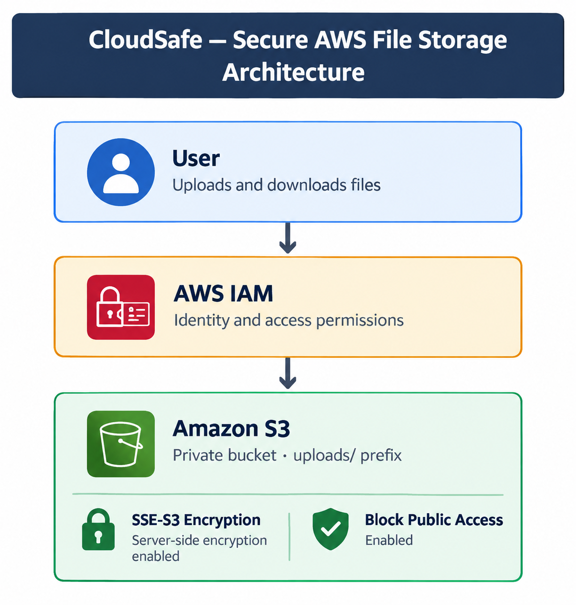
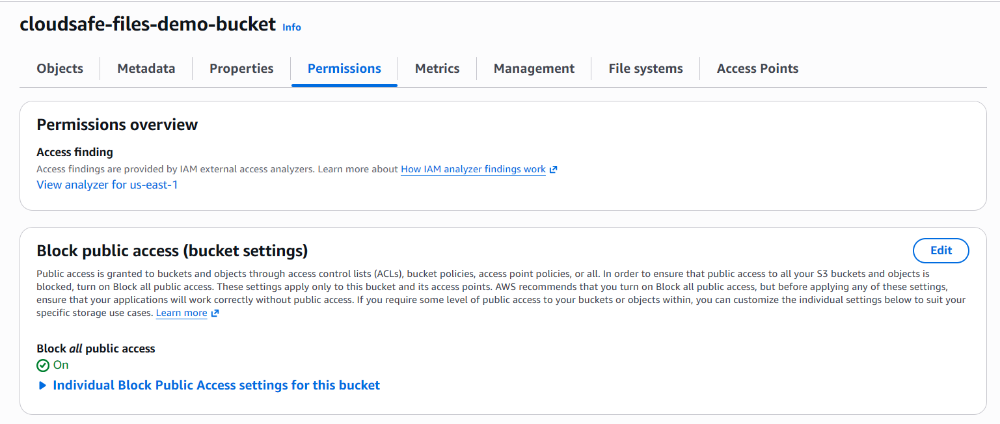
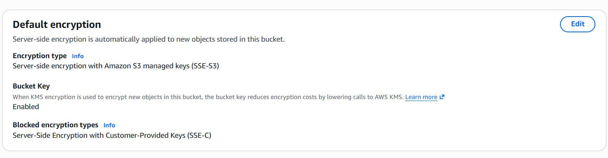
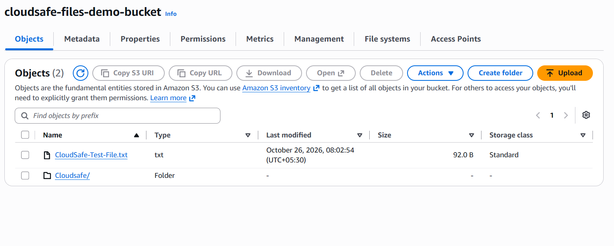
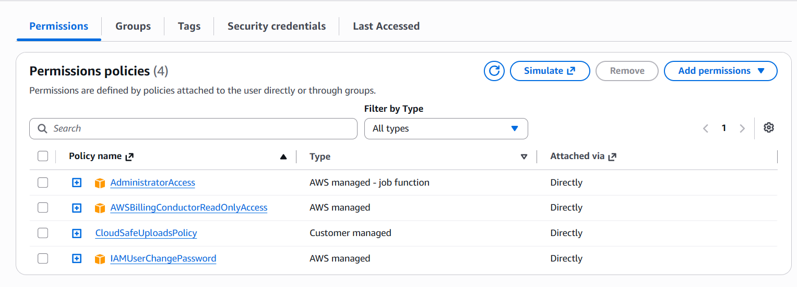

# CloudSafe — Secure Cloud File Storage on AWS

## Project Overview
CloudSafe is a beginner-friendly cloud storage project built with Amazon Web Services (AWS). It demonstrates object storage, identity and access management, encryption at rest, and basic cloud security validation.

## AWS Services
- **Amazon S3:** Stores files as objects in a private bucket.
- **AWS IAM:** Manages user permissions through an IAM policy.
- **SSE-S3:** Provides server-side encryption for stored objects.
- **AWS CloudTrail:** Can be used to review supported account activity.

## Implemented Features
- Created an S3 bucket for CloudSafe.
- Kept S3 Block Public Access enabled.
- Enabled SSE-S3 default encryption.
- Created an `uploads/` prefix for test files.
- Created and attached `CloudSafeUploadsPolicy`.
- Successfully uploaded and downloaded a test file.

## Testing
- Verified test-file upload and download.
- Reviewed the IAM policy using the IAM Policy Simulator.
- Further validation of effective permissions is pending.

## Security Considerations
The bucket is configured to block public access and use SSE-S3 encryption. Effective access depends on all applicable IAM policies and bucket settings; least-privilege enforcement requires further validation.

## Learning Outcomes
- Understanding S3 buckets and objects.
- Configuring default encryption.
- Working with IAM policies.
- Testing cloud-storage operations.
- Documenting security configuration and validation.

## Future Improvements
- Complete least-privilege permission validation.
- Review CloudTrail events.
- Add an optional user interface for file operations.
- Document architecture, testing evidence, and cost considerations.

## Project Screenshots

### Architecture Diagram

### Security Configuration

### Encryption

### Upload Test

    
### IAM Policy

### CloudSafe – Secure AWS File Storage

- Developed an AWS cloud-storage project using Amazon S3 and IAM to manage file access securely.
- Configured a private S3 bucket with default SSE-S3 encryption and restricted IAM permissions for the `uploads/` prefix.
- Tested upload, download, and access-denial scenarios using AWS CLI to validate least-privilege access controls.